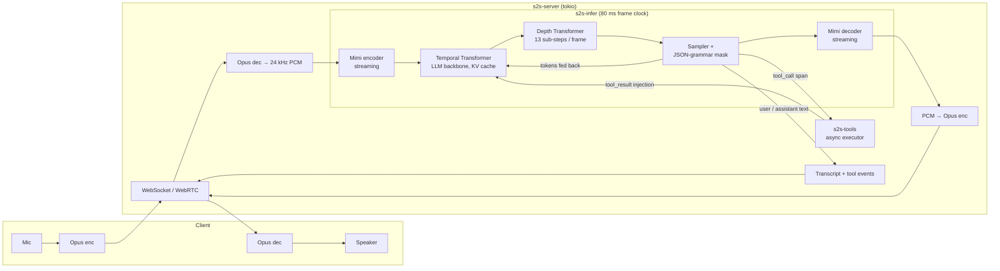
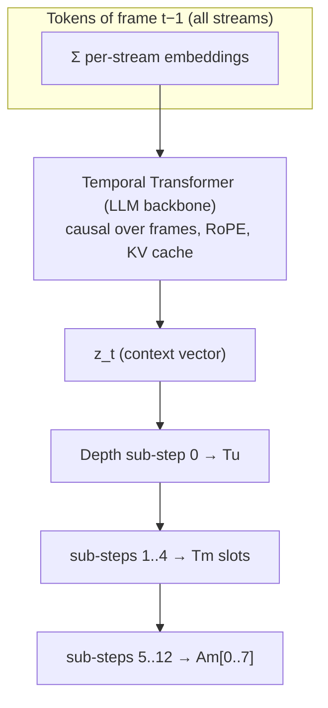
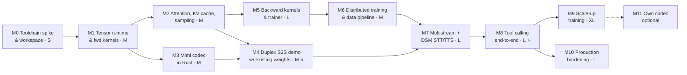

# rust_s2s — Implementation Plan

**A full-duplex speech-to-speech model with built-in STT, TTS, LLM reasoning and tool calling, trained and served on CUDA from Rust.**

| | |
|---|---|
| Status | v0.3: everything verifiable without a GPU is built (see the status table in §12). Nothing has run on a GPU; no model trained beyond tiny CPU runs |
| Scope | GPU kernels, training runtime, model, data pipeline, streaming server |
| Primary references | Kyutai *Moshi* / *Mimi* (2024), Kyutai *Delayed Streams Modeling* (DSM, arXiv 2509.08753), NVIDIA *CUDA Rust* (cuda-oxide, cuTile Rust) |

---

## Table of contents

1. [Goals and non-goals](#1-goals-and-non-goals)
2. [Design at a glance](#2-design-at-a-glance)
3. [Model design](#3-model-design)
4. [Tool calling design](#4-tool-calling-design)
5. [One model, three endpoints: S2S, STT, TTS](#5-one-model-three-endpoints-s2s-stt-tts)
6. [Software architecture (Rust workspace)](#6-software-architecture-rust-workspace)
7. [GPU compute layer and kernels](#7-gpu-compute-layer-and-kernels)
8. [Training system](#8-training-system)
9. [Training recipe and data](#9-training-recipe-and-data)
10. [Streaming inference runtime and server](#10-streaming-inference-runtime-and-server)
11. [Evaluation](#11-evaluation)
12. [Milestones](#12-milestones)
13. [Compute and hardware budget](#13-compute-and-hardware-budget)
14. [Risks and mitigations](#14-risks-and-mitigations)
15. [Open decisions](#15-open-decisions)
16. [Appendices](#16-appendices)

---

## 1. Goals and non-goals

### Goals

- **One fused model.** A single decoder-only network listens, transcribes the user (STT), reasons (LLM), speaks (TTS), and emits tool calls. There is no ASR → LLM → TTS cascade.
- **Full duplex, low latency.** The model listens while it talks, so it handles barge-in, backchannels and overlapping speech. The target is under 250 ms from the end of a user's speech to the model's first audio on one H100 at batch 1, and under 400 ms at production batch sizes.
- **Streaming media in and out.** Opus audio over WebSocket (and optionally WebRTC). Live user transcripts, live assistant transcripts and tool events come back as side channels.
- **Reliable tool calling.** Tool calls follow a JSON schema thanks to grammar-constrained decoding. Tools run asynchronously while the conversation keeps going, and results are injected without stopping the audio clock.
- **Rust end to end on the hot path.** Kernels, autograd, optimizer, distributed training, codec, model, inference engine and server are all Rust. Offline data preparation may use existing tools in any language where that saves months.
- **Trainable from scratch *or* fine-tunable from open weights.** Both paths share the same code.

### Non-goals (for v1)

- Pretraining a text LLM from scratch. We initialize from an open-weights LLM.
- Building a general-purpose deep-learning framework. We implement exactly the ops this model family needs.
- Non-NVIDIA backends. A CPU *reference* backend exists for testing only.
- Music or general audio generation.

---

## 2. Design at a glance



Every 80 ms frame the engine:

1. takes in one Mimi frame of user audio (8 codebook tokens),
2. advances the **Temporal Transformer** by one position,
3. runs the small **Depth Transformer** to produce that frame's text and audio tokens:
   - the user transcript token (STT),
   - up to 4 assistant text tokens (inner monologue or tool call),
   - 8 assistant audio tokens (TTS),
4. decodes the assistant audio tokens to 80 ms of PCM and streams it out.

---

## 3. Model design

The architecture follows Moshi's RQ-Transformer (Temporal + Depth Transformer over Mimi tokens with an inner-monologue text stream), with three extensions:

1. **A user-text (ASR) stream.** This is DSM in the "text lags audio" direction, so the model transcribes the user as it listens.
2. **Multiple assistant-text slots per frame**, so tool-call JSON can be emitted faster than 12.5 tokens/s.
3. **Text-only injection segments** for system prompts, tool schemas and tool results.

### 3.1 Audio codec: Mimi-compatible

| Property | Value |
|---|---|
| Sample rate | 24 kHz mono |
| Frame rate | 12.5 Hz (1920 samples = 80 ms per frame) |
| Codebooks used (Q) | 8 residual codebooks × 2048 entries (~1.1 kbps) |
| Codebook 0 | *Semantic* codebook, distilled from a self-supervised speech model (WavLM in Mimi) |
| Codebooks 1–7 | *Acoustic* residual codebooks |
| Architecture | Causal SEANet-style conv encoder/decoder + small causal Transformers in the bottleneck + split RVQ |
| Streaming | Fully causal. Conv state is kept per session, so frame-by-frame encode and decode match offline output |

**Plan:** implement Mimi inference in Rust and load Kyutai's released Mimi weights (check the license; it was CC-BY 4.0 at last check). Training our own codec is an *optional* later milestone (M11). It is a big project of its own (adversarial plus feature-matching losses, distillation) and gives little benefit early on.

### 3.2 Token streams

Each frame *t* carries these streams. *K* is the number of tokens the Depth Transformer produces per frame.

| Stream | Slots per frame | Vocabulary | Role | Generated by model at inference? |
|---|---|---|---|---|
| `Tu` — user text | 1 | base LLM text vocab + specials | Live transcript of the user (STT). **Delayed by `d_u` frames** relative to user audio | Yes (sampled, fed back) |
| `Tm` — assistant text | `m` = 4 | base LLM text vocab + specials | Inner monologue, tool calls. **Leads** assistant audio | Yes |
| `Am` — assistant audio | Q = 8 | 2048 + specials, per codebook | What the model says (TTS) | Yes |
| `Au` — user audio | Q = 8 | 2048 + specials, per codebook | What the user says | No: comes from the Mimi encoder (predicted only as an optional auxiliary training loss) |

`K = 1 (Tu) + m (Tm) + Q (Am) = 1 + 4 + 8 = 13` sub-tokens generated per frame.

**Special text tokens:**

| Token | Meaning |
|---|---|
| `<pad>` | No text this slot (most slots, most of the time) |
| `<epad>` | End of padding: the next slot starts a word. Lets the model time words against its own audio, as in Moshi |
| `<tool_call>` … `</tool_call>` | Delimit a tool call (JSON) in `Tm` |
| `<tool_result>` … `</tool_result>` | Delimit an injected tool result (input only, never sampled) |
| `<tool_cancel>` | Model abandons an in-flight call (e.g. the user changed their mind) |
| `<sys>` … `</sys>` | Injected system prompt / tool schema block (input only) |
| `<inject>` / `<no_audio>` | Marks text-only injection positions (see §3.5) |

### 3.3 Delays (DSM in both directions)

Delays give each stream the right causal relationship:

| Stream | Delay (frames) | Why |
|---|---|---|
| `Tm` (assistant text) | 0 (reference) | Text is decided first and acts as a "script" for the audio (TTS direction: text leads audio) |
| `Am[0]` semantic | 0 | Aligned with text; word audio starts a frame or so after its text tokens |
| `Am[1..7]` acoustic | τ = 1 (configurable 1–2) | Acoustic detail is conditioned on the semantic token, which improves quality. This adds τ×80 ms to latency |
| `Au[0..7]` user audio | 0 | Input, consumed as it arrives |
| `Tu` (user text) | `d_u` = 6 (≈ 0.5 s, configurable) | ASR direction: text *lags* audio so the model has heard enough right context to transcribe |

Appendix A shows a worked frame grid.

### 3.4 Network



**Temporal Transformer.** A standard pre-norm decoder (RMSNorm, RoPE, GQA attention, SwiGLU), initialized from an open-weights LLM.
- **Input** at position *t* is the **sum** of the embeddings of every token in frame *t−1*. Each stream and slot has its own embedding table; the text tables are initialized from the LLM's token embeddings.
- **Output** is `z_t`.
- **Context window:** 3000 frames (4 min) of sliding attention by default, plus a pinned prefix for the system and tool block (§10.4).

**Depth Transformer.** A small causal transformer that runs *within* a frame over the `K = 13` sub-tokens.
- **Input** at sub-step *k* is `proj(z_t) + emb_k(token_{k−1})`.
- **Per-sub-step weights:** each sub-step has its own input embedding and output head, as Moshi does for codebooks. Optionally the linear layers are per-sub-step too.
- **Sizes:** 6 layers, d = 1024 for the M/L configs.

**Loss.** Weighted cross-entropy over all generated sub-tokens:
- **Weights:** text slots weight 1, the semantic codebook strongly upweighted relative to the acoustic codebooks (following Moshi), and `<pad>` targets down-weighted (e.g. 0.5) so padding doesn't dominate.
- **Optional:** an auxiliary loss on `Au` (predicting the user's next audio tokens), as Moshi does when it models both speakers.

### 3.5 Text-only injection segments

System prompts, tool schemas and **tool results** are not speech. They are pushed into the Temporal Transformer as extra positions:
- **Input** at an injection position is `emb_text(token) + e_inject`. Every audio stream gets a learned `<no_audio>` embedding.
- **Loss:** none at injection positions. They are context only.
- **Positions:** RoPE positions continue contiguously, so injection positions take up context like ordinary frames.
- **Training:** synthetic dialogues contain injection segments at the exact frame where a tool result "arrives", so the model learns to read them.
- **Cost at inference:** one *prefill* of n tokens between two frames. That is about 10–20 ms for n = 512 on an H100 for a 7B backbone, so it fits inside the 80 ms frame budget. Larger results are chunked across frames.

### 3.6 Model configurations

| Config | Temporal Transformer | Depth Transformer | ≈ Total params | Purpose |
|---|---|---|---|---|
| **XS** | 12 layers, d=768 (random init) | 4 layers, d=512 | ~150 M | Kernel/trainer bring-up, overfit tests, CI |
| **S** | ~0.5–1 B open LLM | 4 layers, d=768 | ~1 B | First end-to-end trained model, ablations |
| **M** | ~2–4 B open LLM | 6 layers, d=1024 | ~3–4 B | First "good" model |
| **L** | ~7–8 B open LLM | 6 layers, d=1024 | ~8 B | Production |

The base LLM is an open decision (§15). It needs a permissive license, a good tokenizer and strong function-calling ability in text form.

---

## 4. Tool calling design

### 4.1 Requirements

1. The model decides *when* to call a tool, based on conversation it has heard.
2. Tool arguments must be valid JSON matching the tool's schema.
3. The conversation must not freeze. The model can say "let me check that" and keep listening while the tool runs.
4. Results arrive asynchronously and the model then speaks about them.
5. The user can interrupt. The model or the runtime can cancel.

### 4.2 Mechanism

**Declaring tools.** At session start the runtime injects a `<sys>` segment (§3.5) holding the system prompt and the tool schemas, rendered in the base LLM's native function-calling format so we reuse its prior.

**Emitting a call.** The model writes a call into its `Tm` stream: `<tool_call>{"name": "...", "arguments": {...}}</tool_call>`.
- **Speed:** with `m = 4` text slots per frame, it can write **50 text tokens/s** (vs 12.5 with one slot). A typical 40–60-token call takes 0.8–1.2 s, usually overlapping a spoken filler the model is producing in parallel on `Am`. During normal speech (~3–4 tokens/s) slots 1..3 are almost always `<pad>`.
- **Correctness:** while inside a `<tool_call>` span, the sampler applies a **JSON-schema grammar mask** to the `Tm` logits. The mask comes from the declared tool schemas (via the Rust `llguidance` crate or a small purpose-built automaton), so the result is guaranteed to parse and to match the schema.

**Executing it.** When `</tool_call>` is sampled, the runtime parses the call and dispatches it to the async executor (`s2s-tools`), then returns to the 80 ms clock straight away. The model keeps listening and talking.

**Returning the result.** When the result is ready, the runtime injects `<tool_result>{json}</tool_result>` as an injection segment before the next frame. The model has been trained to then speak the answer, naturally and at a good moment: after finishing its current sentence, not mid-word.

**Cancelling.**
- **User interrupts:** if the user barges in with a new request, the model may emit `<tool_cancel>`. The runtime also exposes a cancel API.
- **Late results:** a result for a cancelled call is injected as a short `cancelled` stub, or dropped, according to policy.

**Parallel calls.** Several `<tool_call>` spans can be in flight at once, each with a `call_id`, and results are matched by id.

**Server tools vs client tools.** Tools can run on the server (registered Rust/HTTP handlers) or on the **client**. For client tools, the server sends a `tool_call` event over the WebSocket and waits for a `tool_result` message, as realtime voice APIs do.

### 4.3 Timeline example

```
time →    0.0s        0.8s        1.6s        2.4s        3.2s        4.0s
user  🎤  "what's the weather in Paris?"·····························(silent)
Tu        ·····what's the weather in Paris?  (lags ~0.5s)
Tm        ············<epad>Let me check.<tool_call>{"name":"get_weather",
          "arguments":{"city":"Paris"}}</tool_call>·········It's 18 degrees and sunny…
Am  🔊    ··············"Let me check."··········(quiet/breath)·······"It's 18 degrees…"
runtime                                    ▲ dispatch          ▲ inject <tool_result>
```

### 4.4 Alternatives considered

| Option | Why not chosen as primary |
|---|---|
| Single text slot (pure Moshi layout) | 12.5 tok/s makes a 60-token call take ~5 s. Too slow |
| "Burst mode": pause the audio clock and decode JSON text-only | Breaks full duplex. User audio would have to be queued and replayed, which complicates batching and makes barge-in worse |
| Separate text-LLM sidecar for tools | Not "one fused model". The sidecar lacks prosody and timing context, and adds a second model to serve |
| Tool results as speech (TTS'd into `Au`) | Slow, lossy, and wastes the audio channel |

---

## 5. One model, three endpoints: S2S, STT, TTS

DSM training lets the same weights serve three modes by changing what the runtime forces versus samples:

| Mode | `Au` (user audio) | `Tu` | `Tm` | `Am` | Output |
|---|---|---|---|---|---|
| **S2S** (default) | from mic | sampled | sampled | sampled | Assistant audio + both transcripts + tool calls |
| **STT** | from input audio | sampled | forced `<pad>` | forced silence tokens | Streaming transcript with ~`d_u` latency |
| **TTS** | forced silence tokens | forced `<pad>` | **forced from input text**, paced by the model (see below) | sampled | Streaming speech |

**TTS pacing.** The runtime holds the input text as a queue of words. Whenever the model samples `<epad>` in `Tm` slot 0 (meaning "ready for the next word"), the runtime forces the next word's tokens into the following text slots. The model therefore decides the speaking rhythm. This follows DSM's model-driven text consumption. A voice can be set with a short audio prompt prefilled into `Am`.

**Training support.** A fraction of training samples (~10%) is rendered in each of the STT and TTS configurations, so the modes stay in-distribution.

---

## 6. Software architecture (Rust workspace)

```
rust_s2s/
├── Cargo.toml                 # workspace
├── crates/
│   ├── s2s-core/              # Tensor handle, DType, Shape, Device, CUDA context/streams/events, caching allocator, errors
│   ├── s2s-kernels/           # CPU reference kernels (fwd + bwd) + dense GPU kernels in cuTile Rust (feature `cuda`)
│   ├── s2s-simt/              # Sparse/irregular GPU kernels in cuda-oxide (standalone; Rust 1.99.1, `cargo oxide`)
│   ├── s2s-backend/           # `Backend` trait; `CpuRef` and `Cuda` implementations; cuBLASLt/NCCL via cudarc
│   ├── s2s-autograd/          # Layer-wise explicit backward, activation checkpointing, grad buffers
│   ├── s2s-nn/                # Linear, Embedding(multi-table), RMSNorm, Attention(GQA, RoPE, sliding), SwiGLU, Conv1d, ConvTr1d, RVQ
│   ├── s2s-mimi/              # Mimi codec: streaming encoder/decoder, weight loading
│   ├── s2s-model/             # Temporal + Depth Transformer, stream layout, delay patterns, injection segments, configs
│   ├── s2s-tokenizer/         # HF `tokenizers` wrapper + special tokens + chat/tool templates
│   ├── s2s-data/              # Shard format, dataloader, delay/packing, synthetic tool-dialogue assembly
│   ├── s2s-train/             # Trainer loop, AdamW, LR schedules, mixed precision, DDP/ZeRO/FSDP, checkpoints, metrics
│   ├── s2s-infer/             # Streaming engine: frame clock, KV cache, batch scheduler, CUDA graphs, sampler, grammar masks
│   ├── s2s-tools/             # Tool registry, JSON schema, async executor, client-tool bridge, timeouts, cancellation
│   ├── s2s-server/            # axum WebSocket (+ optional WebRTC), Opus, session mgmt, protocol, auth, metrics
│   └── s2s-eval/              # WER, codec metrics, tool-call accuracy, latency harness
├── tools/                     # CLIs: convert-weights, tokenize-audio, make-shards, gen-tool-dialogues, bench
├── fixtures/                  # Small golden tensors (safetensors) for parity tests
└── docs/
```

**Key external crates:**

| Crate | Use |
|---|---|
| `cudarc` | Driver API, NVRTC, cuBLAS/cuBLASLt, NCCL bindings |
| `cutile` + cuda-oxide (`cuda-device`, `cuda-host`), NVIDIA CUDA Rust | Custom GPU kernels: Tile model for dense math, SIMT model for sparse ops (ADR 0001) |
| `safetensors` | Weight and checkpoint I/O |
| `tokenizers` | Text tokenizer |
| `llguidance` | Grammar-constrained decoding |
| `tokio`, `axum` | Async runtime, server |
| `opus` / `audiopus` | Audio codec at the edge |
| `serde_json`, `jsonschema` | Tool schemas |
| `tracing`, `metrics` | Observability |

### 6.1 Core abstractions

```rust
/// Device-resident tensor. Shapes are dynamic; dtypes are a small closed set.
pub struct Tensor { buf: Arc<DeviceBuffer>, offset: usize, shape: Shape, strides: Strides, dtype: DType }

/// One implementation per device. Only the ops this model family needs.
pub trait Backend: Send + Sync {
    fn gemm(&self, a: &Tensor, b: &Tensor, c: &mut Tensor, epi: Epilogue, stream: &Stream) -> Result<()>;
    fn rmsnorm_fwd(&self, x: &Tensor, w: &Tensor, y: &mut Tensor, rstd: &mut Tensor, stream: &Stream) -> Result<()>;
    fn rmsnorm_bwd(&self, /* ... */) -> Result<()>;
    fn attention_fwd(&self, q: &Tensor, k: &Tensor, v: &Tensor, o: &mut Tensor, lse: &mut Tensor, mask: AttnMask, stream: &Stream) -> Result<()>;
    fn attention_decode(&self, q: &Tensor, kv: &KvCache, o: &mut Tensor, stream: &Stream) -> Result<()>;
    // ... see §7.2 for the full list
}

/// Layers own params + grads and implement explicit forward/backward.
pub trait Layer {
    type Ctx; // saved activations
    fn forward(&self, be: &dyn Backend, x: &Tensor, train: bool) -> Result<(Tensor, Self::Ctx)>;
    fn backward(&mut self, be: &dyn Backend, ctx: Self::Ctx, dy: &Tensor) -> Result<Tensor>;
}
```

**Design decision — explicit layer-wise backward instead of a general autograd graph.** The model is a fixed composition of ~10 layer types. Hand-written backward for each (llm.c style) gives:
- memory use you can predict, and easy activation checkpointing per transformer block,
- easy fusion (e.g. residual add + RMSNorm backward together),
- no dynamic-graph overhead,
- far less code than a general autograd.

A small "tape" just records the layer order for the backward pass. Every layer's backward is checked against finite differences on the CPU backend.

---

## 7. GPU compute layer and kernels

### 7.1 Toolchain strategy

We use NVIDIA's CUDA Rust libraries, announced as **NVlabs/cutile-rs** and **NVlabs/cuda-oxide** and now both maintained in `github.com/NVIDIA/cuda-rust` (Apache-2.0). They provide two kernel models on one shared host runtime (`cuda-core`, `cuda-async`):
- **cuTile Rust (Tile model).** Tensor-style kernels in stable Rust, JIT-compiled through CUDA Tile IR. Needs CUDA 13.2+ (13.3 recommended) and an sm_80+ GPU.
- **cuda-oxide (SIMT model).** A custom rustc backend that compiles `#[kernel]` functions ahead of time to PTX, with explicit threads, atomics, shared memory and warp ops. Alpha; needs a pinned Rust 1.99.1 and the `cargo oxide` driver. *(The crates.io crate called `cuda-oxide` is an unrelated GPL-3.0 project. Never use it.)*

**[ADR 0001](decisions/0001-gpu-toolchain.md)** records the findings and the decision. Following NVIDIA's own guidance (Tile for dense math, SIMT for sparse or irregular work):

| Layer | Choice | Crate |
|---|---|---|
| Context, memory, streams, events, graphs | `cuda-core` / `cuda-async` (shared by both models) | — |
| Dense GEMM (all matmuls) | **cuBLASLt** via `cudarc` (bf16 in, fp32 accumulate, fused epilogues); buffers shared with cuTile through `Tensor::from_foreign` | `s2s-kernels` (later `s2s-backend`) |
| Dense fused kernels: norms, RoPE, SwiGLU, attention fwd/bwd and decode, fused linear + CE, softmax, AdamW, Mimi convs | **cuTile Rust** | `s2s-kernels` (feature `cuda`) |
| Sparse/irregular kernels: token-bitmask masking, embedding gather and atomic scatter-add, delay patterns, KV-cache ring writes, sampling, RVQ search | **cuda-oxide** | `s2s-simt` (standalone, Rust 1.99.1) |
| Collectives | **NCCL** via `cudarc` | — |

All CUDA Rust crates are pinned to **one git revision** of `NVIDIA/cuda-rust`, so both models share a single `cuda-core` runtime and can run on the same streams and buffers.

**What M0 verified without a GPU:**
- **Toolkit:** a CUDA 13.5 toolkit tree assembled from NVIDIA's PyPI wheels (`scripts/fetch-cuda-wheels.sh`) is enough to build and compile-check both models.
- **cuTile kernels:** lowered to Tile IR and assembled by `tileiras` into **cubins** for sm_80/89/90/100 (`tests/cuda_compile.rs`).
- **cuda-oxide kernels:** compiled to PTX and assembled by `ptxas` into **cubins** for sm_80/89/90/100 (`scripts/check-simt.sh`).
- **Reusable NVIDIA kernels:** NVIDIA ships forward-only f16 inference kernels (flash attention incl. GQA prefill and split-K decode, RMSNorm, RoPE, KV cache). **No backward kernels exist; those are ours to write.**
- **Atomics finding:** cuda-oxide currently lowers float `fetch_add` to a compare-and-swap loop rather than native `red.add.f32`. It's correct but may need an inline-PTX fast path for contended scatter-adds.

**Target architectures:**
- `sm_90` (H100/H200) — primary.
- `sm_80` (A100) — supported.
- `sm_100` (B200) — secondary.
- `sm_89` / `sm_86` (L40S, RTX 4090/3090) — for development.
- **Not supported:** sm_70/sm_75 (V100, T4). cuTile needs sm_80+.

**Precision:** bf16 weights and activations, fp32 accumulation, fp32 master weights and optimizer state. FP8 (E4M3) GEMMs for training and inference are a later optimization (M10).

### 7.2 Kernel inventory

Status: every kernel below already has its CPU reference (`s2s-kernels::reference`), with a passing gradient check where it has a backward pass. GPU versions written so far are all f32, compile-checked to cubins, and **not yet run on a GPU**:
- **cuTile:** #2 RMSNorm fwd and bwd (plus a column-sum reduction for `dw`), #4 SwiGLU fwd, #8 fused weighted cross-entropy fwd+bwd, #9 softmax, #10 AdamW.
- **cuda-oxide:** #7 embedding gather-sum fwd and atomic scatter-add bwd, #12 KV-cache ring write, #13 greedy argmax (warp per row), #14 token-bitmask mask, #20 delays.

Each kernel ships with:
- a CPU reference implementation,
- randomized parity tests with per-dtype tolerances,
- a gradient check where it applies,
- a microbenchmark reporting % of memory or compute roofline.

| # | Kernel | Fwd | Bwd | Used by | Track | Priority |
|---|---|:-:|:-:|---|---|---|
| 1 | GEMM bf16 (+bias, +residual epilogues) | ✓ | ✓ (two GEMMs) | All linears | cuBLASLt | P0 |
| 2 | RMSNorm (+fused residual add) | ✓ | ✓ | Transformers | cuTile | P0 |
| 3 | RoPE (applied in-place to Q/K) | ✓ | ✓ | Attention | cuTile | P0 |
| 4 | SwiGLU (fused gate·up activation) | ✓ | ✓ | MLP | cuTile | P0 |
| 5 | Flash attention, causal + sliding window + prefix pin, GQA | ✓ | ✓ | Temporal TT training/prefill | cuTile | P0 |
| 6 | Flash-decoding (split-K over KV cache), batched sessions | ✓ | — | Inference | cuda-oxide | P0 |
| 7 | Multi-table embedding gather-and-sum (K streams → one vector) | ✓ | ✓ (scatter-add) | TT input, depth input | cuda-oxide | P0 |
| 8 | Fused linear + cross-entropy, chunked over vocab, per-target weights, ignore-index | ✓ | ✓ | Text heads (large vocab) | cuTile | P0 |
| 9 | Softmax / log-softmax (small vocab heads) | ✓ | ✓ | Audio heads (2048) | cuTile | P1 |
| 10 | AdamW, multi-tensor fused, + global grad-norm (two-pass reduce) + clip | ✓ | — | Optimizer | cuTile | P0 |
| 11 | Cast / scale / fill / copy-strided | ✓ | — | Everywhere | cuTile | P0 |
| 12 | KV-cache append + ring-buffer write | ✓ | — | Inference | cuda-oxide | P0 |
| 13 | Sampling: temperature, top-k, top-p, Gumbel, with additive logit mask | ✓ | — | Inference | cuda-oxide | P0 |
| 14 | Grammar mask apply (bitset → −inf on logits) | ✓ | — | Tool calls | cuda-oxide | P1 |
| 15 | Causal Conv1d with streaming state (+ELU, folded weight-norm) | ✓ | ✓ (codec training only) | Mimi | cuTile | P1 |
| 16 | ConvTranspose1d with streaming state | ✓ | ✓ (codec training only) | Mimi | cuTile | P1 |
| 17 | RVQ encode (nearest code over 2048 × D, per level, residual update) | ✓ | — (STE in training) | Mimi | cuda-oxide | P1 |
| 18 | RVQ decode (gather + sum over levels) | ✓ | ✓ | Mimi | cuTile | P1 |
| 19 | Depth Transformer "per-sub-step linear" (batched GEMM, weight index = sub-step) | ✓ | ✓ | Depth TT | cuBLASLt grouped / cuTile | P1 |
| 20 | Delay-pattern shift/unshift (stream-wise roll with pad fill) | ✓ | — | Data → model | cuda-oxide | P1 |
| 21 | FP8 GEMM + scaling (per-tensor/per-block) | ✓ | ✓ | Perf | cuBLASLt | P2 |

**Testing strategy:**
- **CPU reference backend:** naive but obviously correct, written in plain Rust and run in CI on every op.
- **Golden fixtures:** small tensors dumped from PyTorch reference implementations (Kyutai's Moshi/Mimi, a reference LLM) and stored as `safetensors` in `fixtures/`. Parity tests compare our CUDA output against them.
- **Gradient checks:** central finite differences in fp64 on the CPU backend, then CUDA vs CPU in fp32 or bf16 within tolerance.
- **End-to-end parity:**
  - Logits for a fixed prompt match the reference LLM within 1e-2 (bf16).
  - Mimi round-trip matches the reference codes exactly for at least 99% of tokens.

---

## 8. Training system

### 8.1 Trainer

- **Loop:**
  - Data loading in a background thread pool, with pinned host memory and async H2D copies.
  - Forward (with activation checkpointing per block), then backward, then all-reduce or reduce-scatter, then AdamW.
  - Logging and checkpointing at fixed intervals.
- **Mixed precision:** bf16 compute, fp32 master weights and Adam moments. No loss scaling is needed with bf16.
- **Schedules:** linear warmup + cosine or WSD decay. Separate LR groups for:
  - pretrained LLM weights (lower LR),
  - new embeddings and depth transformer (higher LR),
  - audio heads.
- **Gradient accumulation** and **sequence packing:** conversations are packed into fixed windows of frames, e.g. 3000 frames ≈ 4 min.
- **Checkpoints:** sharded `safetensors` plus a JSON manifest (step, RNG state, data cursor, config). The format is identical for training resume and inference load.
- **Observability:** per-stream losses (Tu, Tm text, Tm pad, Am semantic, Am acoustic), grad norms, throughput, MFU, memory. Outputs go to stdout, JSONL and optional Prometheus.

### 8.2 Parallelism (in order of implementation)

| Stage | Technique | Needed for |
|---|---|---|
| 1 | Single GPU | XS, S configs |
| 2 | **DDP** (NCCL all-reduce of bucketed grads, overlapped with backward) | S on 8 GPUs |
| 3 | **ZeRO-1/2** (shard optimizer state and grads via reduce-scatter + all-gather) | M config |
| 4 | **FSDP / ZeRO-3** (shard params, prefetch all-gather per block) | L config (7–8B: fp32 master + Adam ≈ 12 bytes/param ≈ 96 GB, which must be sharded) |
| 5 | (Optional) tensor parallel within a node | Only if the per-GPU batch gets too small |

### 8.3 Memory estimate (L config, ~8B params, per 8×H100-80GB node with FSDP)

| Item | Total | Per GPU (÷8) |
|---|---|---|
| bf16 params | 16 GB | 2 GB |
| fp32 master + m + v | 96 GB | 12 GB |
| bf16 grads | 16 GB | 2 GB |
| Activations (3000-frame window, checkpointed per block) | — | ~20–35 GB |
| **Headroom** | | comfortable within 80 GB |

---

## 9. Training recipe and data

We run **two tracks** that share all the code:

- **Track A (fast path to a working product).** Load Kyutai's released Moshi + Mimi weights (license check required). Extend them with the `Tu` stream, extra `Tm` slots, injection segments and tool tokens, then fine-tune for tool calling. The new parameters are the new embeddings/heads and depth sub-steps; the backbone is fine-tuned at a low LR.
- **Track B (own model).** Start from an open text LLM of our choice, plus Mimi weights, and run the full multi-stage recipe below. This gives control over the base LLM, its function-calling prior, language coverage and license.

### 9.1 Stages (Track B)

| Stage | Data | What it teaches | Trainable |
|---|---|---|---|
| **B0. Init** | — | Add special tokens; new embedding tables (audio per codebook, `Tu`, extra `Tm` slots, `<no_audio>`, `e_inject`); init text tables from the LLM | — |
| **B1. Audio pretraining (single speaker)** | Large unlabeled speech (target 100k–1M+ h). Transcripts with **word timestamps** from a strong ASR model for the `Tm` inner monologue; `Au` empty | Speech continuation, text↔audio alignment, TTS direction | All (LLM at low LR) |
| **B2. Text replay** (mixed into all stages, ~20–30% of tokens) | Text-only pretraining + instruction + function-calling corpora, fed through injection-style positions | Keeps LLM knowledge and function-calling ability from degrading | All |
| **B3. Multistream / duplex** | Diarized conversations split into two channels. Real two-channel data (e.g. Fisher, ~2000 h, LDC-licensed) + diarized podcasts/meetings | Turn-taking, overlap, backchannels; ASR direction for `Tu` | All |
| **B4. DSM ASR/TTS shaping** | Parallel speech-text (LibriSpeech, MLS, Common Voice, …) rendered in **STT-mode** and **TTS-mode** layouts (§5) | Accurate low-latency STT on `Tu`; model-paced TTS on `Am` | All |
| **B5. Instruction + tool dialogues (synthetic)** | See §9.2 | Helpful replies, tool calling, waiting for and speaking results, cancellation | All, lower LR |
| **B6. Voice/persona fine-tune** | Small set of high-quality recordings of the target voice(s) | Consistent assistant voice | Depth TT + audio heads (+ LoRA on backbone) |
| **B7. (Optional) preference tuning** | Pairs of model responses, judged for helpfulness, tool correctness, turn-taking | Polish | LoRA / full |

### 9.2 Synthetic tool-dialogue pipeline

Real spoken tool-use data barely exists, so we generate it:

1. **Tool catalog.** Several hundred realistic tool schemas (weather, calendar, search, CRM lookup, order status, payments-in-sandbox, home control, …) plus randomly generated ones for generalization.
2. **Scripts.** A strong text LLM writes multi-turn dialogue scripts. Each script includes:
   - user utterances, with disfluencies, corrections and interruptions,
   - assistant spoken lines plus tool calls (JSON) at the right moments,
   - tool results (realistic JSON, sometimes errors or timeouts),
   - follow-up speech that uses the results,
   - negative cases: no tool needed, missing argument (ask a clarifying question), user cancels mid-call.
3. **Rendering.**
   - **User speech:** a diverse multi-speaker TTS with varied speakers, accents, noise and channel effects.
   - **Assistant speech:** the target assistant voice. In later iterations this is **our own model's TTS mode**, which bootstraps itself.
4. **Timeline assembly** (Rust tool `gen-tool-dialogues`):
   - Place utterances on a two-channel timeline with realistic gaps, overlaps and backchannels.
   - Insert `Tm` tool-call spans packed 4 tokens/frame, overlapping the assistant's filler speech.
   - Insert injection segments at the simulated "result arrival" frame, with sampled latency of 0.2–3 s.
   - Align `Tu`/`Tm` text to audio using the TTS's own timings.
5. **Tokenize.** Mimi-encode both channels offline, apply delays, and write shards.

Target: about 50k–200k synthetic dialogues (1k–5k hours), mixed at roughly 10–20% in B5, with the rest real conversational and instruction data.

### 9.3 Data pipeline mechanics

- **Offline audio tokenization:** all audio is Mimi-encoded once (`tools/tokenize-audio`, GPU-batched), so training never runs the codec.
- **Shard format:** fixed-size binary shards. Each holds frame-major `u16` token arrays per stream, a word-timestamp side table, segment metadata (speaker, source, license tag) and injection segments. They are memory-mapped and read with an index file for random access.
- **Licensing:** every sample carries a license tag, so a training mix can be filtered for commercial use.
- **Alignment and diarization:** offline steps may use existing open-source tools (forced aligners, diarizers) in any language. Only their *outputs* enter the Rust pipeline.

---

## 10. Streaming inference runtime and server

### 10.1 Frame loop (per batch of sessions, every 80 ms)

```
for each tick (80 ms):
  1. collect 1920-sample PCM frame per session  (jitter buffer; silence if missing)
  2. Mimi encode (streaming, batched)           → Au[t] (8 tokens/session)
  3. apply pending injection segments           (chunked prefill, deadline-aware)
  4. Temporal TT: 1 position/session            (flash-decoding over KV cache)
  5. Depth TT: 13 sub-steps                     (sample Tu, Tm×4, Am×8; grammar mask on Tm if inside tool_call)
  6. Mimi decode (streaming, batched)           → 1920 samples/session
  7. emit audio + transcript deltas + tool events; dispatch completed tool calls
```

Steps 2 and 4–6 are captured as **one CUDA Graph per batch-size bucket** (1, 2, 4, …, 64), so launch overhead is near zero. Step 3 runs outside the graph.

### 10.2 Latency budget (target, L config, H100, batch ≤ 16)

| Component | Budget |
|---|---|
| Frame accumulation (inherent) | 80 ms |
| Acoustic delay τ = 1 (inherent) | 80 ms |
| Mimi encode + decode | ≤ 8 ms |
| Temporal TT step | ≤ 15 ms |
| Depth TT (13 sub-steps) | ≤ 12 ms |
| Network + Opus + jitter buffer | 30–60 ms |
| **Mouth-to-ear (model reacting to the user)** | **≈ 200–250 ms** |

Compute per tick has to stay under 80 ms at the target batch size to keep up with real time. The goal is under 40 ms, leaving headroom.

### 10.3 Batching and scheduling

- **Lockstep frame clock** shared by all sessions on a GPU. Sessions join and leave between ticks (continuous batching).
- **Admission control:** a session is admitted only if the projected tick time stays under budget.
- **Injection prefills** (system prompt at session start, tool results) are scheduled as **chunked prefill** in the slack after each tick, so they never stall other sessions' frames.

### 10.4 KV cache and context

- **Paged KV cache** per session (fixed-size blocks), with **sliding-window attention** over the last W frames (default 3000 ≈ 4 min).
- The **pinned prefix** (system prompt + tool schemas) is never evicted.
- **Long conversations:** tool results older than the window drop out. Optionally the runtime injects a running text summary (generated from `Tu`/`Tm` transcripts) as a pinned segment.

### 10.5 Server and protocol

- **Transport:** WebSocket with binary frames (primary). WebRTC (Opus/RTP) is optional for browser/telephony-grade jitter handling.
- **Client → server messages:**
  - `session.start {system_prompt, tools[], voice, mode: s2s|stt|tts}`
  - `audio.chunk {opus}`
  - `text.input {text}` (TTS mode, or typed user turns)
  - `tool.result {call_id, json}` (client-side tools)
  - `session.cancel_tool {call_id}`
  - `session.end`
- **Server → client messages:**
  - `audio.chunk {opus}`
  - `transcript.user.delta {text, t}`
  - `transcript.assistant.delta {text, t}`
  - `tool.call {call_id, name, arguments}`
  - `tool.status {call_id, state}`
  - `turn.event {user_started|user_stopped|assistant_started|assistant_stopped}`
  - `error {…}`
- **Ops:** auth tokens, per-tenant rate limits, Prometheus metrics (tick time, batch occupancy, tool latency, real-time factor), structured tracing per session, optional recording with consent.

---

## 11. Evaluation

| Area | Metric | Dataset / method | Initial target (L) |
|---|---|---|---|
| Kernels | Parity vs reference; % roofline; MFU | Unit + microbench | Parity: all; GEMM-heavy MFU ≥ 40% |
| Codec | Reconstruction quality (e.g. ViSQOL/MOSNet), parity vs reference Mimi | LibriSpeech test | Parity with reference |
| STT (`Tu`) | WER | LibriSpeech test-clean / other, conversational sets | clean ≤ 4%, other ≤ 9% (at `d_u` ≈ 0.5 s) |
| TTS (`Am` in TTS mode) | WER via external ASR, speaker similarity, MOS-style ratings | Held-out text | WER ≤ 3% |
| LLM knowledge | Spoken QA accuracy; text benchmark retention vs base LLM | Spoken versions of QA sets; MMLU-style text evals via injection | ≤ 10% relative drop vs base LLM |
| Tool calling | Tool selection accuracy, argument exact-match, JSON validity (100% with grammar), task success | Held-out synthetic tool dialogues + a spoken adaptation of a function-calling benchmark | Selection ≥ 90%, arg EM ≥ 85% |
| Dialogue | Turn-taking latency, interruption handling, overlap rate, human ratings | Scripted user simulator + human eval | Median response latency ≤ 300 ms |
| Serving | Real-time factor, max concurrent sessions/GPU, p99 tick time | Load test harness | ≥ 32 sessions/H100 at p99 tick < 80 ms |

---

## 12. Milestones

### Status at a glance (2026-11-09)

| Milestone | Done without a GPU | Needs a GPU / external input |
|---|---|---|
| M0 Toolchain | Both CUDA Rust models build; all GPU kernels compile to cubins in CI; ADR 0001; **all kernels and cuBLASLt/NCCL smoke tests pass on an L40S** | Self-hosted GPU CI job; an H100 run |
| M1 Tensor runtime | CPU reference kernels (fwd + bwd); `s2s-nn` layers; `s2s-cuda` cuBLASLt wrapper (compile-checked) | GPU tensor runtime behind the layers; parity on hardware |
| M2 Attention / KV / sampling | KV-cache streaming step (CPU, = full forward to 1e-10); cuTile attention kernels exist upstream; cuda-oxide argmax + KV ring write | Flash-attention fwd/bwd on GPU; CUDA graphs; roofline numbers |
| M3 Mimi | `s2s-mimi`: 100% code parity with Kyutai, streaming = offline; `mimi-tokenize` | Real checkpoint (Hugging Face blocked here); real-time speed |
| M4 Duplex demo, Kyutai weights | `s2s-model::kyutai` (logits within 2.2e-5 of Kyutai); `KyutaiEngine` serves Moshi / STT through the server (fixture output identical to Kyutai's) | Real Moshi/STT checkpoints; GPU speed |
| M5 Trainer | Layers with explicit backward, whole-model gradient checks, AdamW/schedules, bit-exact resume | Same loop on GPU kernels |
| M6 Distributed + data | DDP / ZeRO-1 / sharded checkpoints over `ThreadComm` (= single process); NCCL communicator (compile-checked); `s2s-data` shards/loader | Multi-GPU NCCL run; throughput / MFU |
| M7 Multistream + DSM | `s2s-duplex` (gradient-checked, streaming = training to 1e-10, packed windows); STT/TTS engine modes; tiny model trains on synthetic dialogues | Real data; training at S scale |
| M8 Tool calling | Grammar-constrained calls (llguidance); executor; injection; training data in the runtime's exact formats; engine e2e through the real server | A trained model that calls tools |
| M9 Scale-up | Training driver `s2s-duplex-train` (exact resume) | Compute + data |
| M10 Production | Server (backpressure, admission by session count, turn events), AWS GPU-test launcher | Admission by tick budget, FP8, load tests on GPUs |

**Verified so far (2026-11-09, commit `3e2c5c0`).** 329 CPU tests pass (5 more need real weights, a real tokenizer or a GPU and are ignored); fmt, clippy and docs are clean on Rust 1.99.1; CI is green on all three tiers (cpu, cuda-compile, simt-compile).

**Next steps, in order:**

1. ~~**First GPU run.**~~ Done 2026-11-09 on a persistent GPU dev box (AWS `g6e.4xlarge`, L40S): every cuTile, cuda-oxide and `s2s-cuda` GPU test passes (see ADR 0001). `scripts/aws/run_gpu_tests.py` remains for one-shot runs on fresh instances.
2. **Real weights.** Download Mimi, Moshi and `stt-1b-en_fr` (candle checkpoints) and Kyutai's text tokenizer (convert `tokenizer_spm_*.model` to `tokenizer.json`), then run the ignored tests and serve `KyutaiEngine` with `MimiCodec`. Needs huggingface.co access, which the cloud dev environment blocks.
3. **GPU tensor runtime (M1/M2).** Put the cuTile / cuda-oxide kernels behind `s2s-nn` layers, with parity against the CPU references, then real-time inference for M4.
4. **Training at scale (M5–M9).** Real data, then `s2s-duplex-train` on GPU kernels.

Each milestone has a concrete **exit criterion** that can be demonstrated. Sizes are rough, for a team of 2–3 experienced engineers (S ≈ 1–2 wk, M ≈ 3–5 wk, L ≈ 6–10 wk, XL ≈ 10+ wk, which depends mostly on compute and data rather than code).

Tracks:
- **Foundations:** M0–M2.
- **Inference stack, proven with existing weights before any training:** M3–M4.
- **Training stack:** M5–M6.
- **New capabilities:** M7–M8.
- **Scale and production:** M9–M10.


*(M3 can run in parallel with M2; M4 and M5 can run in parallel; M10 overlaps with M9.)*

### M0 — Toolchain spike and workspace (S)

> **Status (2026-11-09).**
> - **Done without a GPU:**
>   - toolchain investigation and decision record ([ADR 0001](decisions/0001-gpu-toolchain.md));
>   - Cargo workspace;
>   - CPU reference kernels for all of §7.2, with gradient checks;
>   - first cuTile kernels (vector add, RMSNorm fwd, SwiGLU fwd) and cuda-oxide kernels (bitmask, embedding fwd/bwd, delays), all assembled to cubins for sm_80/89/90/100;
>   - CUDA-wheel toolkit script;
>   - CI workflow.
> - **Done on a GPU (L40S, 2026-11-09):** `tests/cuda_parity.rs` (7/7), `s2s-simt-selftest` (6/6), cuBLASLt/NCCL/interop smoke tests in `s2s-cuda` (4/4).
> - **Remaining:** self-hosted GPU CI job; an H100 (sm_90) run.

- Build "hello kernels" in both cuTile Rust and cuda-oxide on an H100 and an RTX-class GPU: vector add, a tiled reduction, a fused RMSNorm, an atomic scatter-add. Record:
  - API ergonomics,
  - compile times,
  - supported arches,
  - debugging story (`compute-sanitizer`, Nsight),
  - generated code quality vs CUDA C.
- Set up the Cargo workspace, CI (CPU-only tests on every PR, GPU tests on a self-hosted runner), formatting, lints and a benchmark harness.
- Set up the `cudarc` context, streams, a cuBLASLt bf16 GEMM and an NCCL all-reduce smoke test.
- **Exit:**
  - a written decision record for which track each kernel class uses,
  - CI green,
  - GPU smoke tests pass on the target hardware.

### M1 — Tensor runtime and forward kernels (M)

- `s2s-core`: tensors, a caching allocator, streams and events.
- `s2s-backend`: CPU reference + CUDA backends.
- Forward kernels #1–4, #7, #11, a naive attention (for correctness), plus safetensors weight loading and the HF tokenizer.
- Load an open LLM (the chosen base, or a small one) and run greedy text generation.
- **Exit:** logits match the reference within tolerance on fixed prompts, and the generated text is identical for 128 greedy tokens.

### M2 — Inference-grade attention, KV cache, sampling (M)

- Kernels: flash-attention forward (#5 fwd), flash-decoding (#6), KV cache (#12), sampling (#13).
- CUDA Graph capture of a decode step, and a batched-decode benchmark.
- **Exit:** text LLM decode reaches at least 70% of memory-bandwidth roofline at batch 1, with no correctness regressions.

### M3 — Mimi codec in Rust (M)

- Kernels #15–18 (forward), with streaming state per session.
- Load Kyutai Mimi weights.
- **Exit:**
  - Offline encode matches reference codes on at least 99% of tokens; decode matches within tolerance.
  - Streaming encode/decode equals offline output.
  - Over 50× real-time on one GPU at batch 1.

### M4 — Full-duplex S2S demo with existing weights (M) ⭐ *first big de-risking milestone*

> **Status (2026-11-09).** Also done since: Mimi (`s2s-mimi`) and the frame loop / server (`s2s-infer` + `s2s-server`); the engine runs our duplex model, and `MimiCodec` plugs Mimi in. `s2s-model::kyutai`: CPU port of Kyutai's multistream LM (temporal transformer + depformer, KV-cached frame stepping, Moshi driver, DSM STT driver), loading Kyutai's candle checkpoints by name. Matches Kyutai's own `moshi` crate on reduced-size fixtures from `tools/kyutai-ref-lm` (logits within 1e-4, tokens exact); every full-size Kyutai config's tensor names/shapes are accepted. `s2s_infer::KyutaiEngine` serves these checkpoints behind the server's `Engine` trait (Moshi for `s2s` sessions, DSM STT for `stt` sessions, one session at a time); on the fixtures it reproduces Kyutai's recorded text, audio codes and words exactly. **Remaining:** run real checkpoints (HF download) with real Mimi and the SentencePiece tokenizer, at real-time speed (GPU).

- `s2s-model` inference path for the Moshi layout (1 text slot, no `Tu`), loading Kyutai Moshi weights.
- `s2s-infer` frame loop and `s2s-server` WebSocket + Opus, plus a minimal web client.
- **Exit:**
  - A live spoken conversation through the browser.
  - Tick time under 80 ms at batch 1 (target under 40 ms).
  - Logits match Kyutai's reference implementation on a recorded input.
- **Why it matters:** this proves the whole streaming design, the codec, the KV cache and the server before we spend anything on training.

### M5 — Backward kernels, layers and single-GPU trainer (L)

> **Status (2026-11-09): CPU half done.**
> - **Built:** `s2s-nn` (layers with explicit backward, activation checkpointing, transformer LM) and `s2s-train` (AdamW with parameter groups and clipping, warmup-cosine / WSD schedules, safetensors checkpoints, gradient accumulation).
> - **Verified on CPU:** a whole-model f64 gradient check passes; a tiny model learns a text corpus; resume from checkpoint is bit-exact.
> - **Remaining:** run the same layers on GPU kernels, and a PyTorch loss-curve comparison.

- Backward for #1–5, #7–10; explicit layer backward; activation checkpointing; AdamW; LR schedules; checkpoints.
- **Exit:**
  - Gradient checks pass for every layer.
  - XS config trained on a text corpus reaches the same loss curve as an equivalent PyTorch reference run (within noise).
  - Training resumes from a checkpoint bit-exactly.

### M6 — Distributed training and data pipeline (M)

- DDP, then ZeRO-1/2, then FSDP; NCCL comms overlapped with backward.
- Shard format, mmap dataloader, offline `tokenize-audio` tool, delay-pattern packing.
- **Exit:**
  - 8-GPU scaling efficiency ≥ 85% for config S.
  - Config M trains on one 8×H100 node.
  - MFU reported. Initial target ≥ 30%, improving toward 40%+ in M10.

### M7 — Multistream model with DSM STT/TTS (L)

- Full stream layout (`Tu`, 4× `Tm`, `Am`, `Au`), delays, injection segments, per-stream losses.
- Train **config S** through stages B1, B3 and B4 on a reduced data mix (~10k–50k h).
- STT-mode and TTS-mode runtime paths (§5).
- **Exit:**
  - The S model holds coherent duplex conversations.
  - STT-mode WER on LibriSpeech test-clean is under 8% (at S scale).
  - TTS-mode intelligibility WER is under 5%.
  - The same checkpoint serves all three endpoints.

### M8 — Tool calling end-to-end (L) ⭐ *feature-complete milestone*

- Synthetic tool-dialogue pipeline (§9.2); grammar-constrained decoding (#14 + `llguidance`); `s2s-tools` executor; client-tool bridge; cancellation; parallel calls.
- **Track A:** fine-tune extended Moshi weights on the tool dialogues.
- **Track B:** run stage B5 on config S.
- **Exit:**
  - Live demo: user asks → model says a filler → tool executes → model speaks the result, with no audio gap over 300 ms.
  - Held-out tool eval: selection ≥ 85%, argument exact-match ≥ 80% (S/Track A), 100% schema-valid JSON.

### M9 — Scale-up training, Track B (XL, compute-bound)

- Train config M, then L, through B1–B6 with the full data mix.
- Run ablations (text slots m, delay `d_u`, τ, pad weight, text-replay ratio).
- **Exit:** meet the §11 targets for L.

### M10 — Production hardening (L, can overlap with M9)

- Batching scheduler and admission control, paged KV, chunked injection prefill, FP8 GEMMs, multi-GPU serving (one model replica per GPU with a session router).
- Load tests, observability, auth and rate limits, safety filters on `Tm` text, recording/consent policy.
- **Exit:** at least 32 concurrent sessions per H100 with p99 tick under 80 ms, and a 24 h soak test with no leaks or desyncs.

### M11 — (Optional) own codec

- Train a Mimi-style codec in Rust (adversarial, feature-matching and distillation losses), e.g. to target other languages or sample rates, or to remove the dependency on third-party weights.

---

## 13. Compute and hardware budget

Audio at 12.5 frames/s is **cheap in tokens**: 1 hour = 45,000 Temporal-Transformer positions. Rough training FLOPs use `≈ 6 × N_params × positions`, with a ~2–3× allowance for the depth transformer, attention and inefficiency:

| Run | Params (temporal) | Audio hours | Positions | Temporal FLOPs | ≈ H100-hours (at ~40% MFU, ×2.5 overhead) |
|---|---|---|---|---|---|
| S, M7 | 1 B | 50k | 2.25 × 10⁹ | 1.4 × 10¹⁹ | ~25 |
| M, M9 | 3 B | 500k | 2.25 × 10¹⁰ | 4.1 × 10²⁰ | ~700 |
| L, M9 | 8 B | 1M | 4.5 × 10¹⁰ | 2.2 × 10²¹ | ~3,800 |

These are **per epoch, per stage**. Multiplying by the number of stages, multiple epochs and ablations gives an estimate of **~10⁴ H100-hours** for a full Track B program at L scale. That is weeks on 32–64 H100s, not months on thousands, *because we do not pretrain the text LLM*.

The real constraint is **data**: licensed, diverse, conversational two-channel speech is scarce, which is why synthetic data and Track A matter.

**Hardware plan:**
- **Development:** 1–2 GPUs (RTX 4090 / L40S / H100) per engineer.
- **M6–M8:** one 8×H100 node.
- **M9:** 4–8 nodes for a few weeks.
- **Serving:** H100/L40S. Estimate capacity in M10.

---

## 14. Risks and mitigations

| Risk | Likelihood | Impact | Mitigation |
|---|---|---|---|
| CUDA Rust immaturity (cuTile and cuda-oxide are both pre-1.0: bugs, missing features, API churn) | High | Medium | `Backend` trait isolation; one pinned git revision for all CUDA Rust crates; driver-free cubin compile checks in CI for both models; cuBLASLt/NCCL for the heavy lifting; each kernel has a CPU reference to fall back on |
| Kernel numerical bugs silently hurting training | Medium | High | CPU reference + golden fixtures + grad checks + PyTorch parity runs (M5) before any expensive training |
| Achieved MFU too low in the custom stack | Medium | Medium | Profile early (Nsight); prioritize attention/GEMM/fused-CE; budget assumes 30–40% MFU |
| Not enough conversational / tool-use speech data | High | High | Synthetic pipeline; Track A starting from duplex-trained weights; license-tagged data mix |
| Synthetic-data artifacts (model sounds "TTS-like", brittle on real users) | Medium | Medium | Diverse TTS voices plus noise/channel augmentation; real conversational data stays the majority; human eval in the loop |
| LLM capability loss from audio training | Medium | High | Text replay (B2); low LR on backbone; track text benchmarks every eval |
| Tool-call latency feels sluggish | Medium | Medium | 4 text slots (50 tok/s); filler speech; parallel calls; short tool-schema names; streaming tool results |
| Real-time deadline misses under load | Medium | High | CUDA graphs; admission control; chunked prefill; per-bucket graphs; p99 tick monitoring |
| Licensing of third-party weights and data | Medium | High | Track every artifact's license; Track B removes dependency on Moshi weights; M11 removes the Mimi dependency |
| Misuse (voice cloning, impersonation) | Medium | High | Fixed assistant voices by default, no arbitrary voice prompts in production; audio watermarking (evaluate); content filtering on `Tm` |

---

## 15. Open decisions

| # | Decision | Options | Needed by |
|---|---|---|---|
| D1 | Base LLM for Track B | Permissively licensed 1B / 3B / 8B open models with strong function calling | M1 (for parity) / M7 |
| D2 | Target GPUs (training and serving) | H100 / H200 / B200 / L40S | M0 |
| D3 | Languages | English first vs multilingual from the start | M7 |
| D4 | Use Kyutai weights (Track A)? | Yes (fastest demo) / No (Track B only) | M4 |
| D5 | Tool execution location | Server-only / client-only / both | M8 |
| D6 | Transport | WebSocket only / + WebRTC / + SIP telephony bridge | M10 |
| D7 | Assistant voice(s) | Licensed voice actor recordings / synthetic voice | M7 (B6) |

---

## 16. Appendices

### Appendix A — Frame grid with delays (`d_u` = 6, τ = 1, m = 4)

Rows are streams, columns are frames (80 ms each). `·` = `<pad>`. Assistant audio tokens are shown as `s` (semantic) and `a` (acoustic). User audio is just "speech present".

```
frame         0    1    2    3    4    5    6    7    8    9   10   11   12   13   14
Au (user)     ████ ████ ████ ████ ████ ░░░░ ░░░░ ░░░░ ░░░░ ░░░░ ░░░░ ░░░░ ░░░░ ░░░░ ░░░░
Tu (STT, +6)  ·    ·    ·    ·    ·    ·    what 's   the  time ?    ·    ·    ·    ·
Tm slot0      ·    ·    ·    ·    ·    ·    ·    <ep> It   's   <ep> three ·   ·    ·
Tm slot1-3    ·    ·    ·    ·    ·    ·    ·    ·    ·    ·    ·    ·    ·    ·    ·
Am[0] (sem)   ∅    ∅    ∅    ∅    ∅    ∅    ∅    ∅    s    s    s    s    s    s    ∅
Am[1..7] (+1) ∅    ∅    ∅    ∅    ∅    ∅    ∅    ∅    ∅    a    a    a    a    a    a
```

The model starts answering at frame 7, before `Tu` has finished transcribing the question. The LLM backbone has already "heard" it through `Au`. `Tu` is an output for transcripts and tool grounding, not a bottleneck.

### Appendix B — Example per-frame token budget

| | Count / frame | Rate |
|---|---|---|
| Temporal TT positions | 1 | 12.5 /s |
| Depth TT sub-steps | 13 | 162.5 /s |
| Max assistant text tokens | 4 | 50 /s |
| User text tokens | 1 | 12.5 /s |
| Audio tokens out | 8 | 100 /s (1.1 kbps) |

### Appendix C — Example tool-call wire events

```jsonc
// server → client
{"type":"transcript.user.delta","text":"what's the weather in Paris","t":2.48}
{"type":"transcript.assistant.delta","text":"Let me check.","t":2.64}
{"type":"tool.call","call_id":"c_17","name":"get_weather","arguments":{"city":"Paris","unit":"celsius"}}
// client → server (client-side tool) — or executed server-side
{"type":"tool.result","call_id":"c_17","json":{"temp":18,"conditions":"sunny"}}
// server → client
{"type":"tool.status","call_id":"c_17","state":"injected"}
{"type":"transcript.assistant.delta","text":"It's 18 degrees and sunny in Paris.","t":4.10}
```

### Appendix D — References

- Défossez et al., *Moshi: a speech-text foundation model for real-time dialogue*, Kyutai, 2024 (Moshi, Mimi, inner monologue, RQ-Transformer).
- Kyutai, *Streaming Sequence-to-Sequence Learning with Delayed Streams Modeling*, arXiv 2509.08753 (DSM; Kyutai STT/TTS).
- Kyutai STT: <https://kyutai.org/stt>
- NVIDIA, *CUDA Rust* (cuda-oxide and cuTile Rust): <https://github.com/NVIDIA/cuda-rust> (formerly <https://github.com/NVlabs/cuda-oxide> and <https://github.com/NVlabs/cutile-rs>), <https://developer.nvidia.com/cuda/rust>, forum announcement: <https://forums.developer.nvidia.com/t/introducing-cuda-rust-two-tracks-for-writing-gpu-kernels/382704>
- Elibol et al., *Fearless Concurrency on the GPU* (cuTile Rust), arXiv 2606.15991.
- Dao et al., *FlashAttention-2* (2023) and Shah et al., *FlashAttention-3* (2024).
- Rajbhandari et al., *ZeRO: Memory Optimizations Toward Training Trillion Parameter Models* (2020).
- `cudarc` (Rust CUDA bindings), `llguidance` (constrained decoding), Hugging Face `tokenizers` and `safetensors`.
